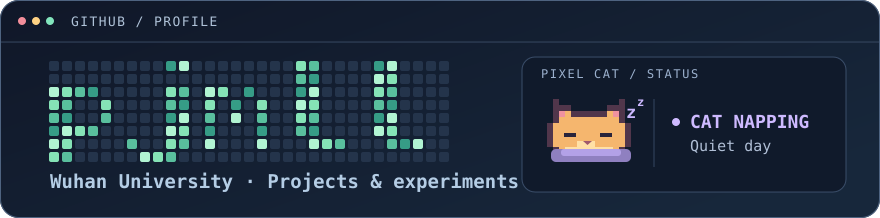
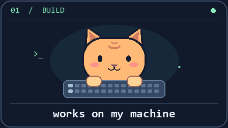
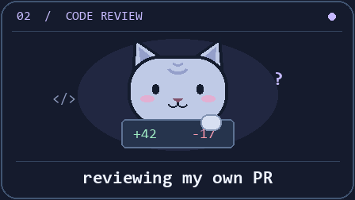
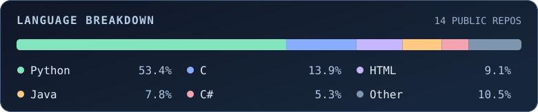

  

我在这里记录做过的实验，也写一些能派上用场的小工具。

  
  

## 代表项目

| 项目 | 做了什么 |
| --- | --- |
| [p2d](https://github.com/pjmll/p2m) | 科研 PDF 阅读工具，支持 OCR、逐段翻译和结构化 Markdown 导出。 |
| [LTN-MNIST-Addition](https://github.com/pjmll/LTN-MNIST-Addition) | 用两张手写数字图像的和作为监督信号，实验逻辑约束下的数字识别。 |
| [ForensicsToolkit](https://github.com/pjmll/ForensicsToolkit) | 提取和分析浏览器历史记录，生成可交互的取证报告。 |

## 常用工具

`Python` · `PyTorch` · `SQLite` · `Git`

## 编程语言

按公开自有项目仓库的代码字节统计，排除 fork 和个人主页仓库。每天更新。

## 贡献记录

<picture>
  <source media="(prefers-color-scheme: dark)" srcset="https://raw.githubusercontent.com/pjmll/pjmll/snake-output/snake-dark.svg">
  
</picture>
